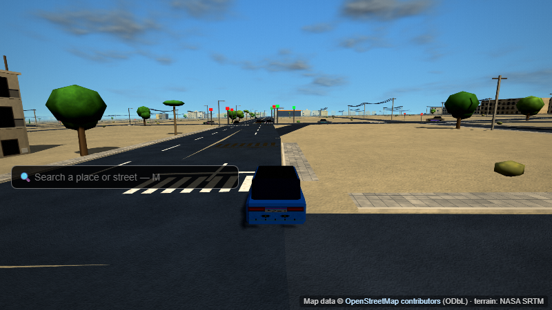

# Irbid Drive

An open-world 3D driving sandbox set in Irbid, Jordan, built on real map data. The streets, building footprints and
places come from OpenStreetMap, and the terrain comes from NASA SRTM elevation data. Drive in traffic, drift for points, race,
rob the bank, and navigate the city. The whole game is one self-contained HTML file (Three.js r128 + WebGL, no framework,
no backend).

**Play in your browser:** https://yousefkhasawneh512-stack.github.io/car_race/ (live once GitHub Pages is switched on: Settings → Pages → Source: GitHub Actions).

**Roblox version (starter, untested in Studio):** `roblox/` (see `roblox/README.md`), generated from the same map data by `tools/make_roblox.js`.

**Author:** Yousef Khasawneh

> **AI-generated code:** the source code in this repository was written with AI assistance (Anthropic's Claude), under
> the author's direction and review. It is a hobby project, not production software.



## Play

Open `dist/irbid-drive.html` in a modern desktop or mobile browser. An internet connection is needed the first time, because
Three.js loads from cdnjs. The world takes a few seconds to build. For play without a connection, `python tools/make_offline.py`
writes `dist/irbid-drive-offline.html` with Three.js r128 inlined (zero network requests).

| Key | Action |
|---|---|
| W / S or ↑ / ↓ | gas / brake + reverse |
| A / D or ← / → | steer |
| Space | handbrake (drift) |
| C | camera: chase / cockpit / bonnet / bumper (placed for each car) |
| R | start a race at the nearest circuit, or duel the car next to you |
| E | rob the bank (when near it); elsewhere, in Realistic handling: shift up (selects the manual gearbox) |
| Q | shift down (Realistic, manual gearbox; refused if the engine would over-rev) |
| X | horn (hold) |
| Z | auto-drive along the current route (set one with M first); any steering, gas or brake input takes over |
| U or P | Apex Drift Customs: upgrades (drift points) and the repair bay (JD, priced per part) when near it |
| G | wheel spin (unlock cars with JD) |
| N / B | cycle owned cars |
| M | search places, neighbourhoods and streets / turn-by-turn directions; category chips (food, shops, schools …) and ☆ saved places |
| H | handling: Arcade (default) / Realistic (engine, gears, traction, suspension, two-axle tyre model: slip angles, weight transfer, countersteer) |
| I | vehicle damage mode: Off / Cosmetic / Full |
| O | vehicle diagnostics: damage report, per-wheel tyres, racing-wheel status |
| J / K | stunt ramps / landmark tour teleport |
| T / F | +1 hour / reset to start |
| Esc | pause menu: **driving school** (5 lessons on real streets), sound volumes, graphics quality (Auto/Ultra/High/Medium/Low), traffic density (High/Medium/Low/by time of day), text size, reduced motion, driver assists (ABS / traction control / stability, Realistic), tyre temperature and brake fade (optional, Realistic), frame-time meter, handling, damage, gearbox (Auto/Manual), weather (Auto/Clear/Cloudy/Rain), clock (game time / Irbid local time), road reputation (the wheel's Back button too) |
| L | mute / unmute sound |
| V | racing-wheel setup (Logitech G29: live readings, pedal/clutch calibration incl. combined pedals, force feedback via WebHID in Chromium) |

On touch devices, on-screen pads appear (steer left/right, brake, gas, drift).

**Sound** starts on your first click or key press (browser autoplay rule). Every car's engine is **synthesised** in the browser from its
engine layout (cylinders, V/flat/inline/rotary, turbo/supercharger/diesel/electric/hybrid): there are no recordings, so it is an
approximation, not the real car. Tyres squeal from actual tyre slip; wind, road, gravel, nearby traffic and impacts are synthesised too.

**Weather and time (Esc menu):** weather is **simulated, not live**. In Auto, the chance of rain each month comes from the Jordan
Meteorological Department's climate table for Irbid (1985–2018 rain days per month, read from the Asia/Amman calendar), so it rains in
winter and almost never in summer. Rain greys the sky, shortens the view, draws rain and makes the roads darker and glossier; in
Realistic handling a wet road also reduces tyre grip (up to −28 %, an estimate from published wet/dry friction ratios). Arcade grip never
changes. The clock can follow Irbid's real local time instead of the 16-minute game day.

**Auto-drive (Z)** follows the route you set with **M** through the real street network, using the same car physics as you: it keeps
right, keeps to the speed limit, stops at red lights and for cars ahead, slows for curves and stops at the destination. Any steering, gas or
brake input takes control back. It is a simple rule-based driver, not a self-driving system, and it can be blocked (it gives up after 6 s).

**Traffic remembers you (road reputation, 0–100, Esc menu):** hitting traffic, red lights, wrong-way driving and speeding lower it; clean
driving earns it back. Low reputation makes drivers behind you keep their distance and lose patience (honk) sooner; a car you hit always
honks. The three named racers remember wins, losses and hits, and one you keep beating tries harder. Fixed, documented rules (no machine
learning); saved under its own key.

**Racing wheel (V):** steering axis + inversion, lock, dead zone, centre offset, response curve, smoothing; pedal/clutch calibration;
button binding (defaults: right paddle shift up, left paddle shift down; a layout saved by an earlier version keeps its buttons); force feedback through WebHID in Chrome/Edge. Tested with simulated input only: the author's real G29 has not been
verified by these tests.

**Vehicle damage** (button top-right or **I**; each car keeps its own damage, saved in the browser):

| Mode | What happens |
|---|---|
| **Off** (default) | Nothing is recorded. The car drives exactly as in earlier versions. Roadside objects are solid. |
| **Cosmetic** | Dents where you hit, bumpers that crack, hang and tear off (they stay on the road), folding/snapping mirrors, buckled bonnet and boot lid, bowed doors, windscreen cracks that grow from the impact point, shattered side windows, broken lamps, paint scratches, flat tyres and bent rims. Performance is never reduced. Signs, poles, slim trees, garden walls and bus-shelter glass can break; guardrails deflect; walls get scrape marks; dumpsters get shoved. |
| **Full** | Everything above, plus mechanical damage: engine/radiator (overheating), transmission, driveline, steering, brakes, suspension per corner, wheel alignment (the car pulls), worn/overheated/punctured tyres lose grip. Hard landings damage the suspension. |

- **Diagnostics (O):** every component with its condition and effect, a top-down body map, and a card per wheel (tread,
  carcass, temperature, grip, load, slip, wear by cause, distance on the tyre).
- **Repairs** are done at **Apex Drift Customs** (Baghdad Street; U/P there; the Repair button routes you there). Each body panel,
  light, window, mechanical part, suspension corner and tyre is listed with its condition, effect and price in JD; repair one part
  or everything. "Full inspection" shows all 42 parts, including the ones in good condition. Prices come out of your JD balance
  and are gameplay estimates, not real workshop quotes.
- **Burnout** (Cosmetic/Full): throttle + brake at a standstill (front-wheel drive: throttle + handbrake). It only works if the car
  has the power to overcome its driven wheels' grip, so strong rear-drive cars can, all-wheel drive and weak cars can't. Burnouts and
  drifts heat and wear the tyres that are actually spinning or sliding.
- Car masses, layouts and strengths are **gameplay estimates** (see `manifest/cars.json`); there is no crash-test data.
- **Speed bumps** are real raised geometry: each axle rides over the profile, the body heaves and pitches, and fast crossings jolt the car
  (and in Cosmetic/Full can bottom out the suspension). 2 come from OpenStreetMap; the other 88 are estimated positions near schools,
  clinics and parks (`manifest/speed_bumps.json`).
- **Traffic signals** show red/amber/green lamps facing each approach (60 s cycle, 3 s amber, all-red clearance). 3 junctions are mapped in
  OpenStreetMap; 14 are estimated major crossroads (`manifest/signals.json`). Traffic stops at red; running one costs a fine.

**Gameplay:**
- **Drift points** come from sliding the car and buy per-car upgrades (speed, acceleration, handling, extra drift).
- **JD** comes from the fine system and bank-heist loot and pays for the car-unlock wheel. There are 217 car models in 5 rarity tiers.
- **Progress** is saved in the browser's `localStorage`.

## Develop

The source is split into parts under `src/parts/`. `build.py` concatenates them in a fixed order into
`dist/irbid-drive.html`, and that order is also the dependency order.

```bash
python build.py                                   # -> dist/irbid-drive.html
npm install                                       # three@0.128.0, used by the headless tests
node tests/boot.js dist/irbid-drive.html          # one headless check (stubbed DOM, real three.js)
node tests/realism_test.js dist/irbid-drive.html  # damage / breakable poles / speed bumps (PASS/FAIL)
node tests/damage_test.js dist/irbid-drive.html   # localized damage, modes, tyres, burnouts, objects (50 checks)
node tests/off_trace.js dist/irbid-drive.html     # damage Off = identical physics to v38
pip install playwright && python -m playwright install chromium
python tests/drive_pw.py dist/irbid-drive.html    # real-browser check
python tests/damage_pw.py dist/irbid-drive.html   # real-browser damage screenshots
python tools/check.py                             # quick project check (build, syntax, JSON, assets, core tests); --full = everything
python tests/xbrowser_pw.py dist/irbid-drive.html # Chromium + Firefox + WebKit, phone/tablet emulation
```

**Phones and tablets:** play in landscape; Quality Low and Traffic Low run best. **Android / iOS app:** `app/` is a Capacitor 8 wrapper
around the offline build (`python tools/make_app_www.py`, then `cd app && npx cap sync`); building needs Android Studio or a Mac with Xcode.
See `docs/PLATFORM_SUPPORT.md`. Asset licences: `docs/ASSET_SOURCES_AND_LICENSES.md` and `assets/manifests/`.

The game's map data is already baked into `src/parts/03a`–`03d`, so building and playing need nothing else. The raw
OpenStreetMap/SRTM input files are **not included in this repository**. Only the converter scripts are
(`osm/gen_world.py`, `osm/net.py`, `osm/bld/conv.py`, `osm/overpass/*.py`, `osm/terrain/gen_terrain.py`). Places are refreshed
with `python osm/overpass/fetch.py` (downloads from the Overpass API) then `python osm/overpass/build.py --game`. Never edit the generated `src/parts/03a`–`03d` files by hand.

More detail for contributors:
- `CLAUDE.md`: architecture, constraints and the test baseline.
- `PLAN.md`: roadmap.
- `CHANGELOG.md`: version history.
- `AUDIT_REPORT.md`: v39 audit (what changed, what is real, what is estimated, what is missing).
- `DATA_SOURCES_AND_LICENCES.md`, `manifest/`: data sources, licences, car / place / photo / object manifests.

## Accuracy notes

- Road centrelines, building footprints and places are real OpenStreetMap data. Road widths and speed limits are typical
  values for each road class unless OSM tags them. Building heights are mostly estimated, and OSM coverage of Irbid is incomplete.
- About 1,660 searchable places (shops, mosques, schools, landmarks, neighbourhoods, villages) and about 46,000 real buildings across the
  whole map. Where OSM has no buildings, simple generated ones fill in. Landmarks stand at their OSM positions; see
  `PLACE_IMPORT_REPORT.md` and `NAME_CORRECTIONS.md` for what was checked, corrected and is still uncertain.
- The terrain uses a 1 km SRTM grid, so narrow valleys are smoothed out.
- The speed bumps are **estimated** positions near mapped schools, clinics and parks, not surveyed locations.
- Car durability, masses, handling and economy values are gameplay balance, not real-world data. The cars are simple
  procedural shapes sized to each car, not licensed 3D models.
- Schools are under-mapped in OSM: the Ministry of Education lists 1,358 schools in Irbid governorate; OSM maps 146 in the play area.

## Data attribution

- Map data © [OpenStreetMap contributors](https://www.openstreetmap.org/copyright), available under the Open Database
  License (ODbL). Building data come from a BBBike extract of OSM (2026-10-10) and the Overpass API (2026-10-17, outside that extract); places from the Overpass API (2026-10-17).
- Elevation: NASA SRTM v3 (1 arc-second), retrieved via the OpenTopoData API.
- [Three.js](https://threejs.org) r128 (MIT).
